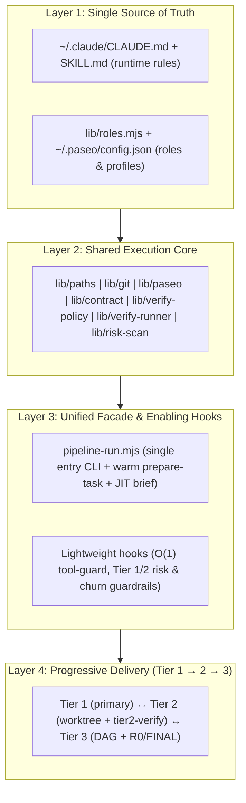

# Harness Architecture Decision Records (ADRs)

> **Authority boundary:** Live execution rules live exclusively in `~/.claude/CLAUDE.md` (global rules, Stop points, Tiers, Review scope/budget) and `skills/paseo-pipeline/SKILL.md` (Tier 3 orchestration). ADRs in this directory record **why** the harness is shaped this way, what alternatives were rejected, and how future iterations evolve. ADRs are **never** injected into runtime prompts (zero context-token tax).

## North-Star Architecture

**Enabling Harness Formula:**
`Single Source of Truth` + `Shared Execution Core` + `Progressive Unified Contract` + `Warm Environment & JIT Context` + `Self-Healing ACI & Self-Pruning Telemetry`.

## Decision Index

| ID | Title | Status | Target / Baseline |
|---|---|---|---|
| [ADR-0001](0001-single-source-and-shared-core.md) | Single Source of Truth, Shared Execution Core & Unified CLI Facade | Accepted | Landed (`lib/paths`, `lib/paseo`, `lib/git`, `lib/verify-policy`, `pipeline-run.mjs`) |
| [ADR-0002](0002-progressive-contract-and-recon-routing.md) | Recon-First Tier Routing & Progressive Unified OpenSpec Contract | Accepted | Landed (`aba7238` / `e373d11`; retired `TIER-PLAN` transcript parsing) |
| [ADR-0003](0003-bounded-sdd-review-and-oracle-fidelity.md) | Bounded SDD Review (1+1 Budget), Oracle Fidelity & Caveat Guard | Accepted | Landed (plus Tier 1 Stop risk sentinel & Tier 2/3 matrix sync) |
| [ADR-0004](0004-enabling-harness-environment-and-context.md) | Enabling Harness: Warm Worktrees, JIT Context & Self-Healing ACI | Accepted | Landed (worktree `--hydrate`/`--workspace-dir`, JIT `brief.mjs`, O(1) `tool-guard`) |
| [ADR-0005](0005-harness-telemetry-and-self-pruning.md) | Lightweight Local Telemetry & 30-Day Self-Pruning Governance | Accepted | Landed (`lib/telemetry.mjs`, `pipeline-run.mjs report`) |

## 5-Question Fitness Gate (Before Any New Rule, Hook, or Script)

Every change to prompts, hooks, or pipeline scripts must answer:

1. **Single Source:** Does it introduce a second rule copy, path matcher, role list, or parser instead of reusing a shared module?
2. **Enable Before Deny:** Can the harness auto-heal or pre-warm this deterministically instead of denying the agent and burning turns?
3. **Cross-Tier Symmetry:** Does the invariant hold consistently across Tier 1, Tier 2, and Tier 3 (no Tier 1/2 escape hatch)?
4. **Measurable & Prunable:** What real failure mode does it prevent, and how will we detect if it becomes dead weight (0 hits in 30 days or >20% false positives)?
5. **Runtime Cost:** Does it add permanent prompt tokens or synchronous large-file I/O on hot hook paths?

## Conventions

- Keep each ADR ≤ 70 lines, focused on **one** architectural decision.
- Never silently rewrite past decisions to erase history: mark superseded ADRs `Superseded by ADR-NNNN` and keep retired prose in `docs/history/`.
- Do not copy dynamic numeric thresholds or CLI flag lists into ADRs; link to the authoritative source instead.
