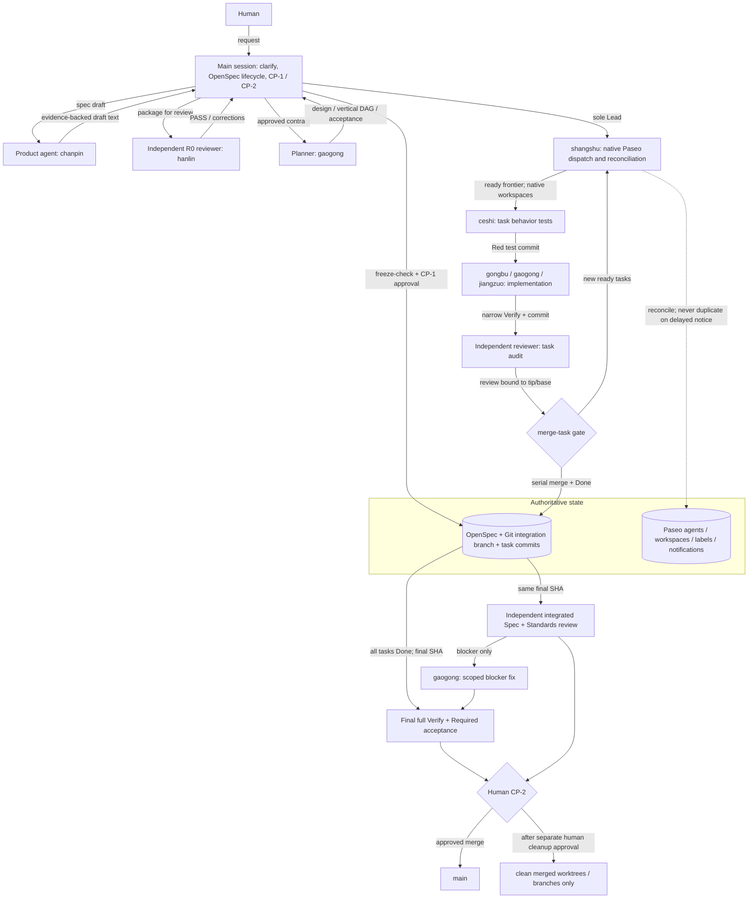

# Paseo Pipeline Architecture

Non-normative overview. Current workflow authority: `skills/paseo-pipeline/SKILL.md`. Runtime role selection always reads live Paseo profiles/agents; the table below is a dated snapshot (2026-11-01) of this machine's `~/.paseo/config.json` for review only. Briefs never hardcode models.



## Role snapshot (provider/model as configured)
| Role | Profile | Provider/model | Mode | Duty | Writes? |
|---|---|---|---|---|---|
| Lead | shangshu | claude/flash | bypassPermissions | frontier dispatch, reconcile, serial `merge-task` | no business code |
| Spec author | chanpin | claude/gemini | auto | Proposal/Spec/Digest as text | no (main session writes) |
| R0 / arbiter | hanlin | claude/cc | bypassPermissions | one package review; one-turn ruling | no |
| Planner / senior fixer | gaogong | codex/glm | auto-review | Design/Tasks/Acceptance; hard tasks; final blocker fixes | scope-limited |
| Tester | ceshi | codex/codex | auto-review | Red behavior tests before implementation | test paths only |
| Implementer | gongbu | claude/flash | auto | default vertical-slice implementation | task scope |
| UI implementer | jiangzuo | claude/kimi | auto | UI tasks | task scope |
| Reviewer | anchasi | codex/gpt | auto-review | TASK / FINAL review; fix-diff recheck | read-only by brief |

Independence is checked at model level by `merge-task.mjs`: it resolves each agent's `provider/model` from `paseo ls --all --json` (falling back to `paseo inspect` for a unique prefix) and blocks when the test author and implementer share a model, or when the reviewer shares a model with the implementer. The CLI provider alone is **not** a proxy for the model family — several profiles share `claude` as their shell but run different models. Not enforced: reviewer != tester. Current profiles have `ceshi=codex/codex` and `anchasi=codex/gpt`, but profile values drift; use `list_profiles` as the live authority and choose another reviewer profile when model independence from the tester is required. `merge-task` only warns on that overlap. `anchasi` is not OS-read-only; read-only is brief-level.

## Single-task sequence
```mermaid
sequenceDiagram
  participant L as Lead
  participant T as ceshi
  participant W as implementer
  participant R as reviewer
  participant G as merge-task + Git
  L->>T: tester.md (task workspace/branch)
  T-->>L: Red commit (behavior failure) + notify
  L->>L: verify Red on branch tip
  L->>W: writer.md (same workspace/branch)
  W-->>L: Green narrow Verify, tip + envelope
  L->>R: reviewer.md TASK (base..tip)
  R-->>L: pass(reviewer@tip/base) or blockers
  L->>G: merge-task.mjs (scope, trailers, independence, Verify)
  G-->>L: Done line; backfill ready frontier
```
A missing notification triggers reconcile of Paseo status + branch tip, never a duplicate dispatch.

## Operating constraints
- Task execution uses vertical slices and frontier scheduling; no wave-wide wait barrier.
- Git records completed work; Paseo supplies agents, workspaces, labels, and notifications.
- `freeze-check.mjs` validates the frozen contract; `merge-task.mjs` is sole task merge and Done writer.
- Only genuine DAG concurrency enters Pipeline (`maxWidth >= 2`, at least 4 tasks); otherwise Tier 2.
- CP-1 freezes scope. CP-2 confirms main merge. Cleanup and push remain separate human decisions.

## Tier 2: handoff for transfer, `/implement` for method

Tier 2 covers work that is too large for one in-place session but has no real DAG
concurrency. Two mechanisms could carry it; they are not alternatives.

- **`/paseo-handoff` is the transport.** It creates the worktree, writes the brief,
  and pins the acceptance command and the "stop if you exceed this" boundary. It
  deliberately does not impose a development method, and it is the only one of the
  two that is model-invocable from an orchestrating session.
- **`/implement` (plus `/tdd` at pre-agreed seams, then `/code-review`) is the
  method.** Inside the handed-off worktree the implementing agent follows the
  ticket→Red→Green→review loop. `to-spec`/`to-tickets` are deliberately *not*
  chained: OpenSpec already owns the contract for any change that went through
  `freeze-check`, and a second ticket tracker would duplicate that authority and
  add an external dependency for work with `maxWidth < 2`, where a task graph buys
  nothing.

So: Pipeline when there is DAG concurrency; otherwise `/paseo-handoff` carrying an
`/implement` brief. Do not open a Pipeline for a serial change, and do not chain a
parallel task graph onto a handoff — the handoff's single worktree is the boundary.
