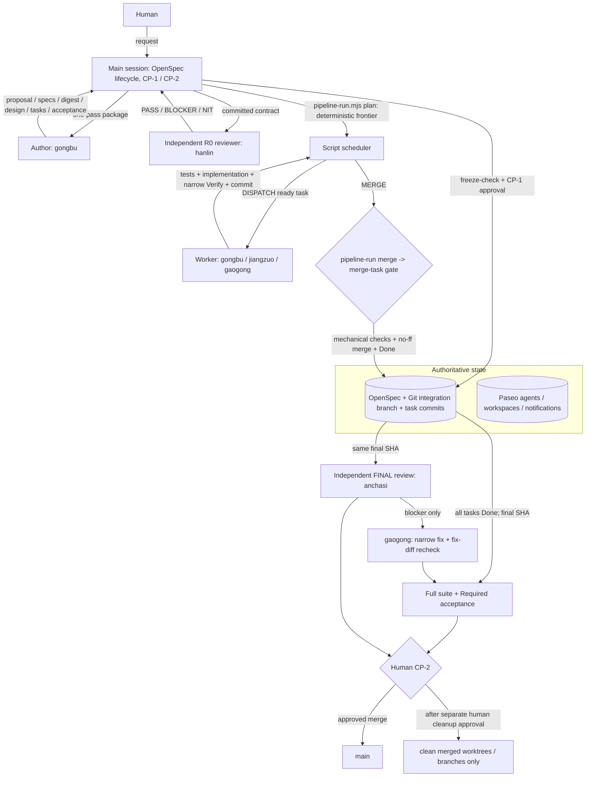
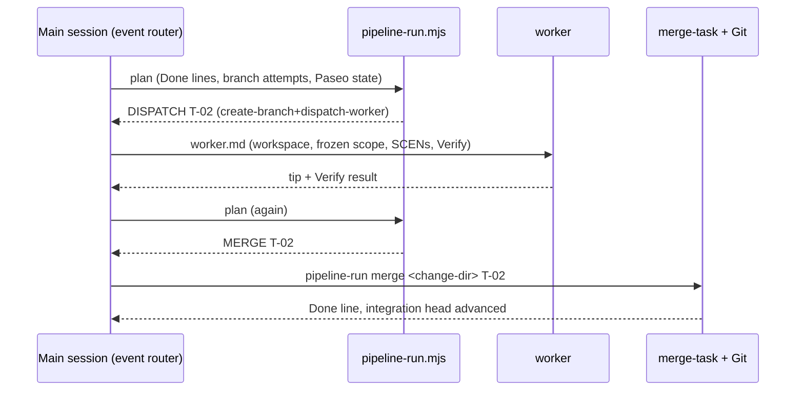

# Paseo Pipeline Architecture

Non-normative overview. Current workflow authority: `skills/paseo-pipeline/SKILL.md`. Runtime role selection always reads live Paseo profiles/agents; the table below is a dated snapshot (2026-11-04) of this machine's `~/.paseo/config.json` for review only. Briefs never hardcode models.

## Role snapshot (provider/model as configured)
| Role | Profile | Mode | Duty | Writes? |
|---|---|---|---|---|
| Author | gongbu | auto | the whole contract package in one pass | contract files only |
| R0 reviewer / arbiter | hanlin | auto-review | one package review before CP-1; one-turn ruling | no |
| Worker | gongbu / gaogong / jiangzuo | auto | tests + implementation + narrow Verify + commit for one task | task scope |
| FINAL reviewer | anchasi | auto-review | the single integrated Spec + Standards review | no |
| Fixer | gaogong | auto-review | narrow repair of a confirmed FINAL blocker | narrow scope |

`ceshi` (test author) and `shangshu` (Lead) are retired. A legacy branch may still carry a `ceshi` commit and `merge-task` accepts it for merge compatibility; no process dispatches either role. Model heterogeneity is now a gate property, not a merge gate: the pipeline requires the author, R0 reviewer, and FINAL reviewer to be different providers/models from each other, and resolves that with `list_profiles` at dispatch time. `merge-task.mjs` no longer inspects reviewer or model identity — it checks the mechanical facts only.

## Single-task sequence

A missing notification triggers `plan` reconciliation of Paseo state + branch tips, never a duplicate dispatch.

## Operating constraints
- Task execution uses vertical slices and a deterministic frontier; no wave-wide wait barrier and no per-task reviewer.
- One worker owns a task end to end: tests, implementation, narrow Verify, commit. Tests and implementation may be written in either order.
- Git records completed work; Paseo supplies agents, workspaces, and finish notifications.
- `freeze-check.mjs` validates the frozen contract; `merge-task.mjs` is the sole task merge and Done writer. The merge gate proves scope, provenance, dependencies, drift, Verify, and regression — not test quality.
- Only genuine DAG concurrency enters Pipeline (`maxWidth >= 2`, at least 4 tasks); otherwise Tier 2.
- CP-1 freezes scope. CP-2 confirms main merge. Cleanup and push remain separate human decisions.

## Tier 2: handoff for transfer, `/implement` for method

Tier 2 covers work that is too large for one in-place session but has no real DAG
concurrency. Two mechanisms could carry it; they are not alternatives.

- **`/paseo-handoff` is the transport.** It creates the worktree, writes the brief,
  and pins the acceptance command and the "stop if you exceed this" boundary. It
  deliberately does not impose a development method, and it is the only one of the
  two that is model-invocable from an orchestrating session.
- **`/implement` (plus `/tdd` at pre-agreed seams, then `/code-review`) is the
  method.** Inside the handed-off worktree the implementing agent follows the
  ticket→Red→Green→review loop. `to-spec`/`to-tickets` are deliberately *not*
  chained: OpenSpec already owns the contract for any change that went through
  `freeze-check`, and a second ticket tracker would duplicate that authority and
  add an external dependency for work with `maxWidth < 2`, where a task graph buys
  nothing.

So: Pipeline when there is DAG concurrency; otherwise `/paseo-handoff` carrying an
`/implement` brief. Do not open a Pipeline for a serial change, and do not chain a
parallel task graph onto a handoff — the handoff's single worktree is the boundary.
