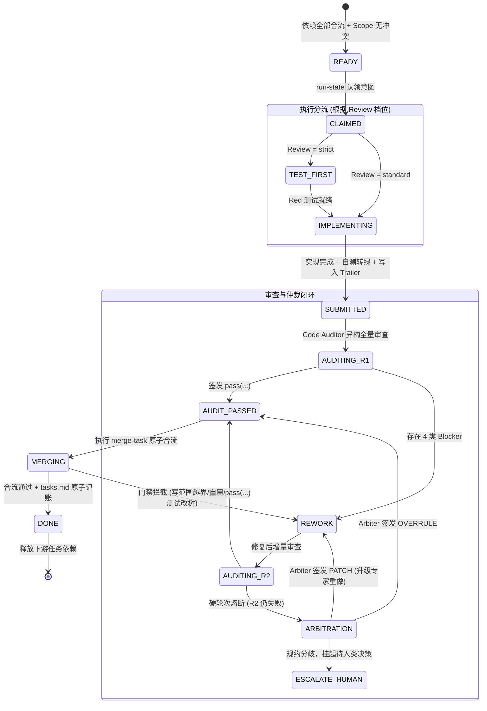

# 规范驱动开发（SDD）下的异构多 Agent 协同编排架构设计指南

> **版本**：v1.0.0  
> **适用场景**：复杂研发流程、中大型软件迭代、代码重构、规范驱动工程交付  
> **核心目标**：解耦特定客户端依赖，建立基于规范驱动（SDD, Specification-Driven Development）的高效、自治、防越权、端到端闭环的多 Agent 协同体系。

---

## 目录

- [一、 执行摘要与核心设计原则](#一-执行摘要与核心设计原则)
- [二、 系统全景架构图](#二-系统全景架构图)
- [三、 标准角色定位与 Profile 矩阵](#三-标准角色定位与-profile-矩阵)
- [四、 基于 SDD 的规约体系与契约机制](#四-基于-sdd-的规约体系与契约机制)
- [五、 调度引擎、状态机与意图账本](#五-调度引擎状态机与意图账本)
- [六、 上下文管理、信封协议与通信约束](#六-上下文管理信封协议与通信约束)
- [七、 端到端闭环与机械安全门禁](#七-端到端闭环与机械安全门禁)
- [八、 平台解耦与通用客户端落地指南](#八-平台解耦与通用客户端落地指南)
- [九、 典型反模式与设计避坑指南](#九-典型反模式与设计避坑指南)

---

## 一、 执行摘要与核心设计原则

在现有的单 Agent 或初级多 Agent 会话中，软件研发面临四大系统性瓶颈：
1. **上下文撑爆与长程漂移**：会话轮次增加后，模型遗忘前期契约，产生幻觉与随意发挥。
2. **控制面与执行面边界坍塌**：编排者模型在长会话中倾向于自导自演，亲自编写业务代码，导致所有审计与准入机制被单体会话旁路绕过。
3. **自产自审偏见**：同一个模型既写实现又自验代码，对自身的逻辑漏洞和边界缺损具备天然盲区。
4. **形式主义与假绿灯**：单测通过仅代表模块孤岛逻辑成立，未接入系统真实入口；自动化流程产出大批伪造通过证据。

为了解决上述问题，本体系提出 **规范驱动开发（SDD, Specification-Driven Development）** 下的多 Agent 协同架构，其核心遵循以下五条公理级设计原则：

```
┌────────────────────────────────────────────────────────────────────────┐
│                        SDD 核心设计五原则                              │
├───────────────────┬────────────────────────────────────────────────────┤
│ 1. 契约先于实现   │ 需求必须凝练为机器可校验的精确 Spec 与验收矩阵；   │
│   (Contract First)│ 未冻结契约前，禁止动笔写任何业务代码。             │
├───────────────────┼────────────────────────────────────────────────────┤
│ 2. 控制与执行隔离 │ 编排调度者严禁编写业务源码与业务提交；             │
│   (Plane Split)   │ 机械物理层拦截总控提交，杜绝越权代写。             │
├───────────────────┼────────────────────────────────────────────────────┤
│ 3. 物理沙箱隔离   │ 每个任务必须在专属独立 Git Worktree 执行；         │
│   (Sandboxing)    │ 基于 Commit Trailer 强制追溯作者血统。             │
├───────────────────┼────────────────────────────────────────────────────┤
│ 4. 异构双轴审查   │ 审查员必须采用异族模型（如 Claude 写、GPT 审）；   │
│   (Hetero-Review) │ 区分 Spec 轴与 Standards 轴，执行硬轮次熔断仲裁。  │
├───────────────────┼────────────────────────────────────────────────────┤
│ 5. 实测证据闭环   │ 拒绝占位符与口述估算，验收强制绑定 Commit SHA；    │
│   (Evidence Gate) │ 必须从真实 API/CLI/UI 入口进行端到端全量对账。     │
└───────────────────┴────────────────────────────────────────────────────┘
```

---

## 二、 系统全景架构图

### 2.1 整体分层架构

系统逻辑上清晰划分为四个横向层次与两个纵向贯穿的物理门禁：

```
===================================================================================
                         SDD 多 Agent 体系全景架构
===================================================================================

 [ 1. 规约定义层 (Specification Layer) ]
   OpenSpec 生命周期: init -> proposal -> specs -> tasks.md -> acceptance.md
   * 产物要求: SCEN-* 场景编号、显式错误字面量契约、垂直切片任务、端到端验收矩阵
   * 机械预检: freeze-check (场景闭环核对) + contract-check (断言字面量静态对账)
                                    │
                         ┌──────────▼──────────┐
                         │ 【CP-1】人类确认点 1  │ <── Spec 冻结基线
                         │ (总控收笔，严禁代写)│
                         └──────────┬──────────┘
                                    │
 [ 2. 治理与编排层 (Governance & Orchestration Engine) ]
   * 拓扑调度: Reconcile 动态 DAG 解析 (入度释放 / 资源冲突串行 / Cap=3 背压)
   * 意图账本: Run-State 状态机 (claim -> record -> fail 租约防并发与防脑裂)
   * 协议信封: Brief 模板派发 (目标/Scope/命令/Trailers) 与 <=20 行结果信封
                                    │
                                    ├──────────────────────────┐
                                    ▼                          ▼
 [ 3. 异构执行与审查面 (Execution & Review Plane) ]     [ 任务工作区隔离 (Worktrees) ]
   ┌──────────────────────────────────────────────┐     ┌───────────────────────┐
   │ 严格档任务 (Review: strict):                 │     │  task/<change>/T-01   │
   │   1. QA/Test Engineer 编写 Red 失败断言      │────>│  task/<change>/T-02   │
   │   2. Core Developer 实现转绿 (Green)         │     │  ...                  │
   │ 标准档任务 (Review: standard):               │     └───────────────────────┘
   │   1. Core Developer 直接标准实现             │                 │
   │ 审查面 (独立异构模型):                       │                 │
   │   * Code Auditor 双轴审计 (Spec + Standards) │<────────────────┘
   │   * 熔断升级: System Architect 单回合仲裁    │  提交携带 Trailer:
   └──────────────────────────────────────────────┘  Pipeline-Role / Author
                                    │
                         ┌──────────▼──────────┐
                         │ 原子安全合流门禁    │ <── merge-task 脚本
                         │ (写范围/血统/非自审)│
                         └──────────┬──────────┘
                                    │
 [ 4. 集成验证与交付层 (Integration & Delivery Layer) ]
   * 集成分支: integration/<change> 统一合并
   * 验收双闸门: check-evidence (结构闸门 + 验收闸门)
   * 矩阵验收: 从真实 API/UI/CLI 执行 acceptance.md 矩阵测试
                                    │
                         ┌──────────▼──────────┐
                         │ 【CP-2】人类确认点 2  │ <── 主干合入裁决
                         │ (全量对账，合入主干)│
                         └──────────┬──────────┘
                                    │
   生产交付: 归档规约 (openspec archive) -> 提交 main -> 销毁临时 Worktree
===================================================================================
```

### 2.2 任务级状态流转（DAG 任务生命周期）

每一个原子任务在流水线中经历严格受控的状态转移：



---

## 三、 标准角色定位与 Profile 矩阵

为实现工具解耦与通用落地，将原有特定代号全面重构为**工业级标准角色**。体系分为**控制面（只读/编排）**与**执行面（可写/审计）**两大阵营。

### 3.1 角色定义矩阵

| 标准角色名称 | 架构职责归属 | 核心职能定义 | 权限边界与工具集 | 推荐模型特征与理由 |
|---|---|---|---|---|
| **Orchestrator**<br>(总控编排) | 控制面 | 任务拓扑解析、DAG 并发分发、Worktree 分配、对账推进与重试管控 | **禁止直接修改业务代码**。<br>工具：Git 状态读取、Worktree 管理、任务派发、进程等待 | 长上下文、高复杂逻辑推理（如 Claude 3.7 Sonnet / GPT-4o） |
| **Product Analyst**<br>(需求调研分析) | 控制面 | 现状调研、代码库既有实现探查（Codebase Digest）、Proposal 起草 | **纯只读**。<br>工具：全局搜索 (ripgrep)、代码图谱 (Codegraph)、文档读取 | 大上下文窗口，擅长长文本总结与架构感知 |
| **System Architect**<br>(系统架构仲裁) | 控制面 | 架构与契约（Spec）设计、接口 Schema 制定、双轴审查争议终审仲裁（Arbiter） | **纯只读（仲裁期）**。<br>工具：Spec 校验工具、Diff 对比工具、测试复跑工具 | 强形式化逻辑、零幻觉倾向、高精度决策模型 |
| **QA / Test Engineer**<br>(TDD 测试工程师) | 执行面 (写手) | 针对 `Review: strict` 任务先行编写失败断言（Red 测试）、差分对拍夹具 | 读写权限，**仅允许修改 `test/` 目录**。<br>工具：文件编辑、测试运行器 | 擅长边界条件挖掘与反例构造的模型 |
| **Core Developer**<br>(核心实现工程师) | 执行面 (写手) | 在隔离沙箱中编写业务逻辑代码，驱动单测转绿，提交携带血统签名 | 读写权限，**受限于 `Write scope`**。<br>工具：文件读写、本地单测执行 | 编码速度快、指令遵循度高（如 Sonnet 级别模型） |
| **Senior Specialist**<br>(复杂攻坚专家) | 执行面 (写手) | 攻坚跨模块、并发竞态、状态机重构任务；承接普通写手打回后的升级重做 | 读写权限，高复杂度沙箱。<br>工具：全量代码工具、高级调试器 | 顶级编程与深度思考模型（如 Thinking 模式） |
| **UI/UX Builder**<br>(界面营造工程师) | 执行面 (写手) | 视觉还原、交互状态实现、多视口视觉走查与组件破坏自验 | 读写权限。<br>工具：前端构建工具、无头浏览器 (BrowserKit) | 具备前端审美、CSS/DOM 结构感知与视觉走查能力 |
| **Code Auditor**<br>(独立代码审计员) | 检验面 (只读) | 审查完整 Diff，按 Spec 轴与 Standards 轴进行双轴核对，签发审查验签 | **严格只读**，无写工具。<br>工具：Git Diff、Codegraph、测试执行 | **必须采用与写手异构的模型**（如实现用 Claude，审计用 GPT），防盲区重叠 |

### 3.2 角色 Profile 规范定义示例 (`profiles.yaml`)

脱离客户端绑定后，角色配置以标准 YAML 文件声明，作为多 Agent 容器或调度器的元数据：

```yaml
version: "1.0"
profiles:
  orchestrator:
    title: "总控编排器"
    type: "control"
    model:
      provider: "anthropic"
      name: "claude-3-7-sonnet"
      thinking: { enabled: true, budget_tokens: 4096 }
    sandbox:
      write_allowed: false
      allowed_paths: [".orchestration/**", "openspec/changes/**"]
    brief_template: "templates/orchestrator.md"

  code_auditor:
    title: "独立代码审计员"
    type: "review"
    # 强制异构：使用不同家族模型破除盲区
    model:
      provider: "openai"
      name: "gpt-4o"
      temperature: 0.1
    sandbox:
      write_allowed: false
      tools_denylist: ["Write", "Edit", "Patch"]
    brief_template: "templates/auditor.md"

  core_developer:
    title: "核心实现工程师"
    type: "worker"
    model:
      provider: "anthropic"
      name: "claude-3-7-sonnet"
    sandbox:
      write_allowed: true
      require_trailers: ["Pipeline-Role", "Pipeline-Author"]
    brief_template: "templates/writer.md"
```

---

## 四、 基于 SDD 的规约体系与契约机制

规约驱动开发的核心在于：**“代码只是规范与测试的衍生品”**。未冻结机器可验证的契约前，禁止启动任何代码实现。

### 4.1 规范产物四件套

在每个变更（Change）目录下，标准包含四份关键产物：
1. `proposal.md`：需求背景、痛点、选型方案与架构取舍。
2. `specs/<domain>/spec.md`：基于自然语言契约的系统状态转移声明，必须带编号场景（`SCEN-*`）。
3. `tasks.md`：垂直切片的原子工程任务清单，具备强类型字段。
4. `acceptance.md`：全流程业务验收矩阵（端到端校验表）。

### 4.2 机器可校验 Spec 契约编写标准

自然语言规范极易产生二义性，本架构推行**类型化契约**：
- **场景显式编号**：每个功能与边界必须以 `#### Scenario: SCEN-<模块>-<序号> <说明>` 标识。
- **错误契约字面量声明**：Spec 中严禁模糊书写“参数错误抛出异常”，必须显式写出语言级错误类型与完整消息字面量：
  ```markdown
  #### Scenario: SCEN-AUTH-001 无效 Token 拒绝
  - **WHEN** 客户端传入空 Token 调用 `validateSession()`
  - **THEN** 系统 SHALL 抛出异常 `AuthenticationError("TOKEN_EMPTY")`
  ```
  静态门禁（`contract-check`）将直接提取该字符串，与测试断言做集合比对。

### 4.3 强类型垂直切片任务清单 (`tasks.md`)

任务严禁按水平技术层（如“写后端/写前端/改DB”）切片，必须按功能纵向切片（Vertical Slice），保证单任务可独立验证。任务行语法具备严格机械契约：

```markdown
- [ ] 1.1 T-01 用户注册手机号验重
  - Anchors: src/services/user.ts:registerUser
  - Depends on: none
  - Write scope: src/services/user.ts, test/user-register.test.ts
  - Verify with: npm test -- test/user-register.test.ts
  - Review: strict
  - Risk-surface: [persistence, error-handling]
  - Scenarios: SCEN-USER-001, SCEN-USER-002
```

- **`Write scope`（写范围白名单）**：任务允许触碰的路径前缀集合。合流门禁做 100% 封闭校验，多改一个文件即判定越界。
- **`Verify with`（确定性单命令）**：必须是确定性执行命令（非自然语言描述），合流门禁逐字复跑。
- **`Review`（审查分档）**：
  - `strict`：必须由 QA/Test Engineer 编写 Red 测试先行，随后实现，Auditor 独立审查。
  - `standard`：Core Developer 实现，Auditor 独立审查。
  - `mechanical`：纯配置/文档/无副作用算法，单测绿灯后走机械验签。
- **`Scenarios`（场景认领）**：双向必须闭环。任务引用的场景必须在 Spec 中存在；Spec 中声明的本变更场景必须被至少一个任务认领。

### 4.4 端到端业务验收矩阵 (`acceptance.md`)

单测全部通过并不等于业务可用。业务验收矩阵关注**真实入口（Real Seam）**：

| Scenario | Entry (真实入口) | Tasks | Verify (验证入口命令) | Required | Result | Evidence |
|---|---|---|---|---|---|---|
| SCEN-USER-001 | `POST /api/v1/users` | T-01 | `bash scripts/e2e/test-register.sh` | yes | PENDING | pending |
| SCEN-USER-002 | `POST /api/v1/users` | T-01 | `bash scripts/e2e/test-duplicate.sh` | yes | PENDING | pending |

- **冻结初始态**：`Result` 必须填 `PENDING`，严禁提前填 `PASS`。
- **真入口约束**：`Entry` 必须是 HTTP 路由、CLI 命令、MQ 消息或 UI 操作路径，禁止写底层内部类函数名。

---

## 五、 调度引擎、状态机与意图账本

为了防止多 Agent 并发时的竞态条件、重复派发以及网络抖动造成的脑裂，系统建立基于**轻量文件账本**的调度核心。

### 5.1 意图账本模型 (`run-state.json`)

运行账本记录流水线“正在发生什么”，其生命周期遵循事务级四步转移：

```
           claim (认领)
  [空闲] ───────────────> [CLAIMED (意图挂起)]
                             │
                             │ spawn/dispatch (派发成功)
                             ▼
                        [DISPATCHED (已记录 Agent/PID)]
                             │
            ┌────────────────┴────────────────┐
            │ exit 0 (成功产出)               │ crash/fail (异常中止)
            ▼                                 ▼
   [RESOLVED (待合流/已处置)]            [FAILED (作废意图，允许重试)]
```

#### 幂等复合键设计
每个动作意图拥有全系统唯一幂等键：
$$\text{IdempotentKey} = \langle \text{Change}, \text{Task}, \text{Attempt}, \text{Phase}, \text{Role}, \text{Action} \rangle$$
- 当同一 Key 存在处于 `CLAIMED` 或 `DISPATCHED` 状态的记录时，任何重复的派发请求会被直接拒绝（Exit 2）。
- **编排租约（Owner Lease）**：整个变更运行过程中，生成单代际租约（Lease Generation），防止由于上下文恢复产生两个 Orchestrator 同时操盘造成的资源撕裂。

### 5.2 动态 DAG 推进与容量背压 (Backpressure)

调度引擎每轮触发时执行无状态纯函数计算（`reconcile`）：
1. **入度计算**：仅当前置依赖任务在 Git 集成分支（First-parent）上已拥有合流提交且带有 `Done:` 签名，才被判定为 `DONE`。
2. **写范围冲突串行化**：若任务 A 与任务 B 的 `Write scope` 存在路径前缀重叠，即使在 DAG 上无依赖，调度引擎也强制将其串行化，避免 Worktree 合流时发生文本级代码冲突。
3. **并发容量控制（Cap=3）**：同时处于执行态的任务上限严格限制为 3。超过上限时，即使任务处于就绪态也推入等待队列，防止本地 CPU/内存耗尽及模型 API 遭遇限流。

### 5.3 唤醒机制与死锁防御

系统**彻底摒弃**不可靠的异步事件通知推送，采用**「前台主动等待 + 确定性对账重放」**：
- **主动等待（Active Wait）**：主控派发子 Agent 后，在前台阻塞监控其进程/子会话，设置超时边界（如 540 秒），并实时采集退出码与资源状态。
- **惰性幂等对账**：不论是进程退出唤醒、定时心跳，还是人工介入追问，系统统一以 `node reconcile.js <change>` 重放真实状态图，由真实产物驱动下一步决策，绝不依赖内存或对话历史。

---

## 六、 上下文管理、信封协议与通信约束

长程流水线中最致命的问题是**“上下文污染”与“长消息撑死总控”**。本架构确立严苛的上下文预算控制法则。

### 6.1 极简结构化信封协议 (Result Envelope)

子 Agent 执行完毕后，严禁向总控汇报大段长篇推理或完整代码，必须且仅能输出结构化信封（不超过 20 行）：

```yaml
---
kind: "phase-complete" # phase-complete | turn-idle | blocked
task: "T-01"
attempt: 1
phase: "impl"
role: "core_developer"
result: "SUCCESS"
reviewed_sha: "a1b2c3d"
files_changed:
  - "src/services/user.ts"
  - "test/user-register.test.ts"
verify_output: "12 tests passed, 0 failed, duration: 1.2s"
blockers: []
next_action: "request-audit"
---
```

- **消费纪律**：总控收到信封后，仅做元数据登记与推进决策，严禁把信封中的详细日志二次展开阅读，防止总控上下文迅速耗尽。

### 6.2 派发任务简报模板 (Brief Templates)

总控向子 Agent 派发任务时，不通过零散对话，必须渲染对应的 `templates/*.md` 模板，保证输入要素完备：
1. **目标与不变式 (Invariants)**：本任务实现的核心业务目标及不可破坏的底线。
2. **Base SHA**：当前任务 Worktree 检出的基准提交节点。
3. **Write scope**：允许写入的文件集合。
4. **Verify Command**：自验必须通过的命令。
5. **Trailers 格式要求**：明确 Commit 信息必须携带的元数据字段。

### 6.3 异构双轴审查协议 (Two-Axis Review)

Code Auditor 审查代码时，禁止凭个人编码偏好无限制挑刺，强制分离为两条正交评估轴：

```
                                ┌────────────────────────┐
                                │   代码审查 (Auditor)   │
                                └───────────┬────────────┘
                                            │
                   ┌────────────────────────┴────────────────────────┐
                   ▼                                                 ▼
        【 Spec 轴 (规范对齐度) 】                       【 Standards 轴 (工程质量) 】
  * 场景覆盖: SCEN-* 是否均有断言?               * 模块深度: 是否滥用过度抽象?
  * 错误契约: 字面量是否 100% 吻合?              * 命名与设计: 圈复杂度是否可控?
  * 边界完整: 异常输入是否拦截?                  * 缺陷排查: 是否引入竞态或安全盲点?
                   │                                                 │
                   └────────────────────────┬────────────────────────┘
                                            │
                             ┌──────────────▼──────────────┐
                             │  结论分类判定 (4 类 Blocker) │
                             └──────────────┬──────────────┘
                                            │
               ┌────────────────────────────┴────────────────────────────┐
               ▼                                                         ▼
    【 准入 Blocker 阻断项 】                                 【 Nit 建议项 (放行) 】
  1. SPEC_VIOLATION   (规约违背)                           * 局部变量命名不够优雅
  2. CORRECTNESS_BUG  (逻辑错误)                           * 注释语病或格式微调
  3. SECURITY_DEFECT  (安全漏洞)                           * 个人代码排版偏好
  4. SCOPE_VIOLATION  (越界修改)                           ==> 签发: PASS_WITH_NITS
  ==> 阻断合流，强制进入 R2 修复                                (不阻断合流，避免内耗)
```

- **硬轮次熔断**：单任务最多允许两轮审查（R1 与 R2）。若 R2 仍有 Blocker，说明写手与审查员陷入死锁，**立即触发熔断**，转交 System Architect 执行单回合终审，杜绝无限自旋耗尽 Token。

---

## 七、 端到端闭环与机械安全门禁

整个流水线不相信 Agent 的自我宣称，所有关键节点均由独立脚本执行物理校验。

### 7.1 门禁矩阵全景

```
[需求确立]
   │
   ▼
┌─────────────────────────┐
│ 1. 冻结预检 (Pre-freeze)│ ──> freeze-check.mjs: 场景双向认领 + Scope 闭环 + 命令合法
└───────────┬─────────────┘ ──> contract-check.mjs: 错误声明字面量静态对账
            ▼
┌─────────────────────────┐
│ 2. 人类确认点 1 (CP-1)  │ ──> 人工裁定 Spec 冻结。总控收笔，严禁亲自写代码！
└───────────┬─────────────┘
            ▼
┌─────────────────────────┐
│ 3. 原子合流门禁 (Merge) │ ──> merge-task.mjs: 
└───────────┬─────────────┘     [1] 写范围封闭 (git diff 是否越界)
            │                   [2] 作者血统隔离 (Commit 必须带 Worker Trailer，控制面硬阻断)
            │                   [3] 独立非自审 (Reviewer != Author 且匹配运行账本)
            │                   [4] 冻结验证复跑 (现场执行 Verify 命令)
            │                   [5] 干净树检查 (测试不可在工作区残留副作用)
            ▼
┌─────────────────────────┐
│ 4. 证据双闸门 (Evidence)│ ──> check-evidence.mjs:
└───────────┬─────────────┘     * 结构闸门: 校验字段齐备，拒绝 TODO/TBD 等占位符
            │                   * 验收闸门: 绑定集成 Commit SHA，强制端到端真实测试通过
            ▼
┌─────────────────────────┐
│ 5. 人类确认点 2 (CP-2)  │ ──> 人类审查最终 Diff 与验收证据，授权合流生产主干
└─────────────────────────┘
```

### 7.2 原子合流门禁代码级逻辑 (`merge-task.mjs`)

合流是代码准入的核心卡点。其关键校验逻辑如下（以伪代码形式展示其不变式）：

```typescript
async function verifyAndMergeTask(taskId: string, reviewTag: string, testCmd: string) {
  // 1. 检查工作区干净度
  assertGitClean();

  // 2. 检查前置依赖在 first-parent 提交链上是否已 DONE
  const task = parseTask(taskId);
  for (const dep of task.dependsOn) {
    if (!isTaskDoneInGitLedger(dep)) {
      throw new ExitError(35, `Dependency ${dep} not resolved on integration branch`);
    }
  }

  // 3. 校验作者血统与控制面隔离 (防总控代写)
  const taskCommits = gitLog(`${integrationBase}..${taskBranch}`);
  for (const commit of taskCommits) {
    const role = commit.trailers['Pipeline-Role'];
    const author = commit.trailers['Pipeline-Author'];
    if (!role || !author) {
      throw new ExitError(31, `Commit ${commit.sha} missing provenance trailers`);
    }
    if (['orchestrator', 'architect', 'auditor'].includes(role.toLowerCase())) {
      throw new ExitError(31, `Control role ${role} is FORBIDDEN from committing code`);
    }
  }

  // 4. 校验非自审与账本一致性
  const parsedReview = parseReviewTag(reviewTag); // pass(reviewer@tip/base)
  if (taskCommits.some(c => c.trailers['Pipeline-Author'] === parsedReview.reviewer)) {
    throw new ExitError(32, `Self-review rejected: author cannot review own code`);
  }
  assertReviewMatchesRunStateLedger(taskId, parsedReview.reviewer);

  // 5. 校验写范围封闭性 (Scope Check)
  const changedFiles = gitDiffNameOnly(`${integrationBase}..${taskBranch}`);
  for (const file of changedFiles) {
    if (!task.writeScope.some(prefix => file.startsWith(prefix))) {
      throw new ExitError(30, `Scope violation: ${file} not in declared writeScope`);
    }
  }

  // 6. 现场执行验证命令并检查工作区副作用
  const snapshotBefore = gitStatusFingerprint();
  execSync(task.verifyWith, { timeout: 180000 });
  const snapshotAfter = gitStatusFingerprint();
  if (snapshotBefore !== snapshotAfter) {
    gitResetHard();
    throw new ExitError(20, `Test command modified tracked/untracked files in workspace`);
  }

  // 7. 执行原子合并并提交 Done 标记
  gitMergeSquashOrNoFF(taskBranch);
  appendTaskDoneEntry(taskId, parsedReview.tip, reviewTag);
  gitCommit(`chore(pipeline): merge ${taskId}\n\nPipeline-Task: ${taskId}`);
}
```

---

## 八、 平台解耦与通用客户端落地指南

如果要将上述机制从 Paseo 等特定客户端中剥离，移植到自研多 Agent 平台、开源框架（如 LangGraph, Mastra, AutoGen）或原生 CLI 环境中，仅需提供两个基础抽象接口（SPI）：

### 8.1 抽象 SPI 架构

```
┌────────────────────────────────────────────────────────┐
│           SDD 治理与编排核心 (Pipeline Engine)         │
│   (Reconcile DAG, Run-State, Merge-Task, Evidence)     │
└───────────────────────────┬────────────────────────────┘
                            │
              ┌─────────────┴─────────────┐
              ▼                           ▼
   ┌───────────────────────┐   ┌─────────────────────────┐
   │ Workspace Provider SPI│   │   Agent Runner SPI      │
   │ (物理沙箱与工作区管理) │   │ (多模型会话与执行驱动器) │
   └──────────┬────────────┘   └───────────┬─────────────┘
              │                            │
   ┌──────────┴────────────┐   ┌───────────┴─────────────┐
   │ 实现方案:             │   │ 实现方案:               │
   │ 1. Git Worktree 原生  │   │ 1. CLI 进程池 (Claude/  │
   │ 2. Docker/K8s 容器卷  │   │    Codex/OpenHands)     │
   │ 3. 云端虚拟文件系统   │   │ 2. 统一大模型 API / SDK │
   └───────────────────────┘   └─────────────────────────┘
```

### 8.2 接口规范定义

#### 1. Workspace Provider SPI
负责为每个任务提供绝对干净的独立文件系统空间：

```typescript
export interface WorkspaceProvider {
  /** 基于指定基准创建独立任务工作区 */
  createWorkspace(params: {
    changeId: string;
    taskId: string;
    baseBranch: string;
  }): Promise<{ workspacePath: string; branchName: string }>;

  /** 销毁工作区并清理磁盘 */
  destroyWorkspace(workspacePath: string): Promise<void>;

  /** 异常时保留工作区现场供人类审查 */
  preserveWorkspace(workspacePath: string, reason: string): Promise<void>;
}
```

*轻量本地参考实现（原生 Git Worktree）：*
```bash
# 创建任务隔离沙箱
git worktree add -b task/feat-01/T-01 .worktrees/T-01 integration/feat-01

# 合流完成后无残留清理
git worktree remove --force .worktrees/T-01
```

#### 2. Agent Runner SPI
负责根据角色 Profile 派发任务并获取结构化回执：

```typescript
export interface AgentRunner {
  /** 派发任务并等待终态 */
  dispatch(params: {
    profile: AgentProfile;
    workspacePath: string;
    briefContent: string;
    timeoutSeconds: number;
  }): Promise<AgentExecutionResult>;
}

export interface AgentExecutionResult {
  exitCode: number;
  envelope: ResultEnvelope; // 必须解析出标准信封
  rawLogs: string;
  durationMs: number;
}
```

*轻量 CLI 进程池适配实现（以调用 Claude Code / Codex 为例）：*
```typescript
import { spawn } from 'node:child_process';

export class CliProcessAgentRunner implements AgentRunner {
  async dispatch({ profile, workspacePath, briefContent, timeoutSeconds }) {
    return new Promise((resolve, reject) => {
      // 在任务专属的 Worktree 目录下拉起无交互 CLI
      const child = spawn('claude', ['--print', briefContent], {
        cwd: workspacePath,
        env: {
          ...process.env,
          ANTHROPIC_MODEL: profile.model.name,
          PIPELINE_ROLE: profile.id
        }
      });

      let stdout = '';
      child.stdout.on('data', chunk => { stdout += chunk; });

      child.on('close', code => {
        const envelope = extractEnvelopeFromOutput(stdout);
        resolve({
          exitCode: code ?? 1,
          envelope,
          rawLogs: stdout,
          durationMs: Date.now() - startTime
        });
      });
    });
  }
}
```

---

## 九、 典型反模式与设计避坑指南

基于生产流水线真实踩坑历史，总结以下核心反模式：

| 反模式名称 | 典型不良表象 | 真实危害 | 架构防线与纠偏策略 |
|---|---|---|---|
| **总控代写**<br>(Orchestrator Drift) | 总控 Agent 觉得任务简单，顺手调用 `Write/Edit` 原地修改代码 | 绕过独立审计与 Red-Green 闭环，单体会话产生逻辑盲区 | `merge-task` 强制检验 Commit Trailer，控制面角色提交硬阻断（Exit 31）。 |
| **异步通知依赖**<br>(Async Callback Loss) | 依赖平台消息总线或 Webhook 唤醒总控 | 网络抖动或会话休眠导致通知丢失，全流水线永久停摆 | 改用前台主动阻塞等待（Active Wait）+ 惰性对账重放（Reconcile）。 |
| **自产自审**<br>(Self-Review Bias) | 编写代码的写手同时调用评审工具签发 Pass | 模型对自身的逻辑错误具备盲区，审查形同虚设 | 强制异构审查员（Claude 写，GPT 审），校验 Commit 作者与审查员 ID 互斥。 |
| **假绿灯验收**<br>(Fake Green) | 在验收报告中填写 `Result: PASS`，但证据为 `TODO` 或单测桩 | 模块级单测通过但系统入口走不通，产生虚假交付幻觉 | `check-evidence` 校验必须绑定精确 Git SHA，严格查杀占位符，执行端到端矩阵。 |
| **全量日志塞总控**<br>(Context Flood) | 子 Agent 将几千行编译/单测全量日志返回给总控 | 2 轮任务后总控上下文迅速撑爆（Prompt Too Long），流水线崩溃 | 强制 $\le 20$ 行结构化信封协议，总控只读摘要，详细日志落盘留档。 |
| **水平切片死锁**<br>(Horizontal Slicing) | 任务切为“设计表结构”、“写实体类”、“写业务层” | 任务间互相依赖无法独立运行单测，导致写手相互等待 | 强制垂直切片（Vertical Slice），每个任务必须自带可独立运行的验证命令。 |

---

## 结语

本架构的核心价值不在于引入了多么复杂的多 Agent 对话机制，而在于**通过机械的软件工程门禁与严谨的 SDD 规范，限制 AI 的随意发挥**。

通过将大语言模型限制在明确声明的沙箱空间、写范围白名单、机器可验证 Spec 和严格的非自审提交链条中，真正实现了**确定性交付、可追溯血统、端到端闭环**的企业级多 Agent 自动化研发生态。
