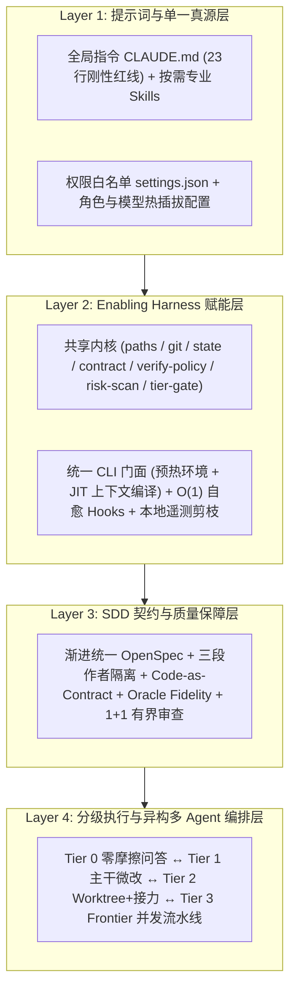
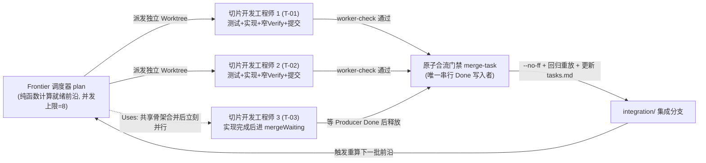

# AI 研发任务编排、SDD 与 Enabling Harness 技术架构白皮书

> **文档定位**：本白皮书面向研发团队，系统阐述从全局提示词原则出发，贯穿 **Tier 0–3 分级任务执行机制、异构多 Agent 编排、SDD（规约驱动开发）工程实践、赋能型 Harness（Enabling Harness）**、**实证有效 vs. 过度设计复盘** 以及 **致命大坑解剖** 的完整架构与核心理念，便于团队深入理解、参考借鉴与渐进落地。

---

## 0. 全局入口与提示词设计原则（`CLAUDE.md` 核心心法）

整套体系不是从一堆自动化脚本起步的，而是从**约束 AI 如何思考、如何对齐目标、何时必须停下由人拍板**的提示词原则起步，随后再用钩子（Hooks）和工程工具链把核心红线变成确定性机制。

### 0.1 全局提示词的四大认知与决策原则

在全局指令 [`~/.claude/CLAUDE.md`](file:///Users/hobart/.claude/CLAUDE.md) 及其演进实践（如 [`CLAUDE.md.bak-20261120`](file:///Users/hobart/.claude/CLAUDE.md.bak-20261120) 与配套专业技能）中，沉淀了四条对任何研发场景都直接有效的原则：

1. **第一性原理与“现象 / 根因 / 真实目标”三元对齐（Root-Cause First）**：
   - 动手修改前，必须先厘清 **`Symptom（现象）/ Root Cause（根因）/ Real Goal（真实目标）`**。如果需求把“症状”当成了“根因”，或把“某种实现手段”当成了“最终目标”，AI 必须当场指明，变更范围须经确认——绝不顺着错误前提盲目写代码。
   - **排障铁律（[`diagnosing-bugs`](file:///Users/hobart/.claude/skills/diagnosing-bugs/SKILL.md)）**：禁止“盯着静态源码空想根因”，强调 **Goal-First + 一手实证**。遇到复杂故障第一步是构建 **Tight Red-Capable Feedback Loop**（能在几秒内稳定复现精确症状的脚本或测试），没有可复现的红灯指令前，禁止提出修复假说；涉及机制或设计缺陷时，必须先画清状态的**入口、出口与恢复路径**，再动单点代码。
2. **三方案推荐 + 最强反对意见（3 Options + Steelman Counter-Argument）**：
   - 面对新机制引入、高风险改动或 Tier 2+ 架构设计时，先提 `≤3` 个真正会改变技术路径的关键问题，随后**给出 3 个具体可行方案 → 明确标注推荐方案 → 必须附上针对推荐方案的“最强反对意见（Strongest Counter-Argument）”**。
   - **为什么必须强制附带“最强反对意见”？** 大模型天生存在“讨好型/证实偏见（Sycophancy）”，不要求自我反驳时，它会把推荐方案论证得毫无破绽；只有强制它以最苛刻对手视角挑刺，才能在动笔前把隐含假设、边界代价与后期返工风险拍在桌面上。
3. **封闭式人类停靠点（Closed Stop Points）与授权边界分离**：
   - 需要人类决策的停靠点收束为封闭清单：**技术选型（Pick an option）、不可逆高危操作（部署、生产写入、数据库迁移、`git push`、Git 历史改写、删分支、`rm -rf`）、上线前复现门禁（Deploy gate）、合入默认主干（CP-2）与范围膨胀（新机制或 Diff >30%）**。
   - 清单之外（如非默认分支 Worktree 内本地提交、读取与本地测试）全部默认放行，避免频繁打断研发节奏。
4. **常驻提示极简化，专项流程按需外置（Progressive Disclosure）**：
   - 全局 `CLAUDE.md` 从早期的 40–60+ 行一路精简到如今的 **23 行**。核心理念：**常驻上下文只保留每一轮都必须遵守的刚性红线与路由索引**，把重度的需求访谈（`/brainstorming`、`/grilling`）、故障诊断（`/diagnosing-bugs`）、并发流水线（`/paseo-pipeline`）和前端交付（`/paseo-ui`）全部分离为按需加载的模块化技能，消除每天白烧固定前缀 Token 的浪费。

### 0.2 北极星架构公式与四层全景

**Enabling Harness 北极星公式**（[`docs/adr/README.md`](file:///Users/hobart/Codex/paseo-skills/docs/adr/README.md)）：
> `Single Source of Truth（单一真源）` + `Shared Execution Core（共享执行核心）` + `Progressive Unified Contract（渐进统一契约）` + `Warm Environment & JIT Context（预热环境与即时上下文）` + `Self-Healing ACI & Self-Pruning Telemetry（自愈人机接口与自剪枝遥测）`

---

## 1. 支柱一：不同任务分级下的执行机制（Tier 0 – Tier 3）

本体系拒绝“无论改 5 行还是改 50 个文件都走同一套重流程”，而是遵循 **Recon-First（先只读探查、再按真实影响面定档）**（ADR-0002），将全部研发任务划分为 4 个渐进档位。

### 1.1 四档执行机制全景对照

| 核心维度 | Tier 0（问答 / 探查 / 诊断） | Tier 1（单域微改） | Tier 2（隔离中型交付） | Tier 3（并发流水线交付） |
| :--- | :--- | :--- | :--- | :--- |
| **准入边界** | 纯只读源码分析、技术提问、线上排障、产品调研 | `≤ 3` 个业务源文件、单一作用域（包/目录）、无 `≥ 800` 行大文件、无 `> 5` 测试文件 | `> 3` 个业务源文件、跨作用域（`≥ 2`）、`≥ 800` 行源码或 `> 5` 测试文件；或 Tier 3 降级路由（`handoff`） | 实质代码/测试任务 `≥ 4`，且满足高并发 ROI：`maxWidth ≥ 3`（或 `maxWidth ≥ 2 && weightedSpeedup ≥ 1.8`） |
| **工作区隔离** | 主目录只读，零工作区隔离 | 直接在主 checkout 编辑与验证 | **必须提前隔离到独立 linked worktree**（冷库需预热依赖） | 独立 `integration/<name>` 集成 worktree + 每任务独立 `task/<name>/<T-id>` worktree |
| **契约要求** | 无 | 无（测试文件与文档修改不计入 3 文件上限） | **Tier 2-Light**：`Contract: none — <reason>` **Tier 2-Heavy**：轻量 OpenSpec（`specs/` + 串行 `tasks.md`） | 完整 OpenSpec（`proposal.md` + `specs/` + `tasks.md` + `acceptance.md`）+ 三段隔离编排 |
| **执行与委派** | 单会话或多路只读 **调研分析员** 并行扇出 | 主会话直接编辑并验证 | Light：主会话直接做 Heavy：冻结契约后按切片交 **切片开发工程师**（或 `≤ 2` 路不相交垂直切片并行） | Frontier 前沿并发调度，单切片开发工程师自测自验提交，`merge-task` 串行原子合流 |
| **质量门禁** | 无 | `Stop` 钩子自动跑 `risk-scan`（风险哨兵）+ 原地打转检测（`churn`） | 收口必跑 `tier2-verify`（Verify + 漂移 + `risk-scan`）；命中风险则走 `1+1` **独立审查员** | R0 契约审查 → 机械中段门禁（`worker-check`/`merge-task`）→ **独立审查员** FINAL 裁决 |
| **核心理念** | **零认知税**：不发分级提醒、不干扰思考 | **低摩擦闭环**：放行 80% 日常修复，防逃逸靠 Hook 兜底 | **双速分流**：轻会话不强迫写 Spec；重/压缩会话强制先冻结契约再切片移交 | **只为真实并发付调度税**：无足够加速比自动退回 Tier 2，绝不硬拆凑数 |

### 1.2 分级机制的四大关键设计特点

1. **Tier 0 零摩擦隔离（ADR-0008）**：[`tier-reminder-hook.mjs`](file:///Users/hobart/Codex/paseo-skills/skills/paseo-pipeline/hooks/tier-reminder-hook.mjs) 自动识别提问、调研、排障语境以及后台系统通知，做到**零规则注入**；面对跨模块排查时，主会话直接并行扇出多个只读 **调研分析员** 子代理收集信息，避免主窗口被海量文件读取塞满。
2. **Tier 1 精确豁免 + 越界刹车**：测试文件与文档对 Tier 1 的 `3 文件` 上限豁免（`UNCOUNTED`），鼓励顺手补单测；一旦修改触及第 4 个业务源文件、第 2 个作用域、`800+` 行大文件或 `> 5` 个测试文件，[`tier-write-hook.mjs`](file:///Users/hobart/Codex/paseo-skills/skills/paseo-pipeline/hooks/tier-write-hook.mjs) 在工具写入前立即拦截；若模型绕过编辑工具改用 `Bash`（`sed -i`/重定向/heredoc），[`tier-stop-hook.mjs`](file:///Users/hobart/Codex/paseo-skills/skills/paseo-pipeline/hooks/tier-stop-hook.mjs) 在回合结束时通过快照比对与 3 轮原地打转检测（`churn`）兜底拦住。
3. **Tier 2-Light vs. Tier 2-Heavy 与重会话刹车**：在 Worktree 内若会话累计压缩 `>= 2` 次，`tier-write-hook` 触发 `worktree_compact_heavy` 阻断无契约扩写源码，强制要求把进展写入 `handoff-progress.md` → 冻结轻量 OpenSpec 契约 → 通过 `brief.mjs tier2` 移交干净上下文的 **切片开发工程师** 逐片接力。
4. **风险正交原则（Risk as a Checkpoint, Never a Tier）**：改动涉及 `auth`（鉴权安全）、`concurrency`（并发幂等）、`persistence`（持久化/Schema）、`money`（资金账务）、`external-write`（外部写入）或削弱既有测试断言时，**在当前 Tier 对称触发 `risk-scan` + `1+1` 独立异构审查**。改 1 个文件的鉴权 Bug 依然留在 Tier 1 做，不必为了“显得慎重”而强行拉进重型多 Agent 流水线。

---

## 2. 支柱二：异构多 Agent 编排机制与模型选型哲学

多 Agent 编排的核心不是“人多力量大”，而是**按认知负载特性匹配标准异构模型、用物理隔离消除自产自审、用极简控制面消除协同损耗**。

### 2.1 职能角色矩阵与异构模型选型哲学

为了解耦底层模型升级与团队协作心智，体系全部以**工程职能定位**定义 Agent 角色，并按**认知特长与成本结构**搭配标准大模型家族：

| 职能角色 | 推荐标准模型选型 | 读写权限边界 | **为什么选这个模型？（核心选型哲学）** |
| :--- | :--- | :--- | :--- |
| **调研分析员** *(Codebase Researcher)* | **Google Gemini**（长上下文高阶推理版，如 Gemini Pro 系列） | **只读**（仅允许输出事实清单 `baseline-facts.md` ≤15KB） | **超长上下文吞吐 + 全局归纳能力强**：跨模块海量源码、日志与历史文档同时入窗不易丢细节，擅长把混沌的现状浓缩成带 `path:line` 锚点的结构化客观事实与需求分析文档。 |
| **契约架构师** *(Contract Architect & Arbiter)* | **Anthropic Claude**（旗舰高阶推理版，如 Claude Opus / Sonnet High-Thinking） | **仅可写契约目录**（`openspec/changes/<change>/`），严禁写业务代码 | **强形式化契约建模 + 指令边界感强**：擅长把调研事实转化为严密的 `SCEN-*` 状态转移规约、无冲突垂直切片 `Write scope` 与任务 DAG，并承担争议仲裁（不可自审自己的契约）。 |
| **切片开发工程师** *(Core Developer)* | **高速高性价比编码模型**（如 **Gemini Flash** 或 **DeepSeek** 高速执行档） | **仅限冻结 `Write scope`**（独立 Worktree 内自测+实现+提交） | **受控填空的最优性价比**：前两步已把接口、`SCEN`、`Write scope` 和 `Verify` 命令全部冻死并 JIT 内联进 Prompt，编程从“开放式猜需求”降维成“有确定性测试护栏的精准施工”。用 Flash 模型跑几十轮 edit-test 循环，速度最快、Token 成本最低。 |
| **复杂攻坚工程师** *(Senior Specialist)* | **强推理编码模型**（如 **Zhipu GLM 高阶推理版** / **OpenAI Codex** / **Claude Opus**） | **仅限冻结 `Write scope`**（接手 `Est: L` / 高风险面 / 复杂返工） | **深推理抗压突破**：当切片涉及跨模块并发竞态、复杂状态机或普通实现返工未过时，切换重型推理模型定点攻坚，不重新规划整体 DAG。 |
| **前端界面工程师** *(UI/UX Engineer)* | **前端与视觉专项模型**（如 **Moonshot Kimi** / **Claude Sonnet**） | **仅限 UI `Write scope`**（联动前端工艺门禁） | **组件结构感知与视觉审美**：专注前端界面还原、交互状态（Loading/Empty/Error/Stressed）、排版与可访问性。 |
| **独立测试工程师** *(QA / Red Test Engineer)* | **OpenAI Codex**（仅 `Review: strict` 时启用） | **仅写测试路径**（其提交对下游写手不可变） | **强反例与边界用例生成**：仅在严格模式下先行提交失败断言（Red），下游强行篡改该测试文件将被合流门禁 `exit 38` 拦截。 |
| **独立审查员** *(Independent Auditor)* | **OpenAI Codex + GPT**（旗舰推理组合，与实现模型严格跨家族异构） | **严格只读**（负责 R0 契约审查 / Tier 2 / FINAL 集成裁决） | **思维盲区去相关 + 冷峻反例构造**：① 绝不用写代码的同一个模型家族自审（防止共同训练偏好导致的盲区重叠）；② **Codex + GPT** 在对抗性边界推演、反例构造以及逐行核对“契约与实现是否真一致”时极其冷峻克制、不讨好、少废话（实测曾一轮精准揪出 3 个真实门禁缺陷）。 |
| **流水线协调器** *(Pipeline Orchestrator)* | **高速高性价比调度模型**（如 Flash 执行档，可选；默认由主会话承担） | **控制面只读/调度**（严禁写业务代码） | 当并发规模过大、主会话上下文吃紧时，在后台接管 Frontier 调度与 Git 对账，不参与具体业务编码。 |

> **真·异构校验机制（[`profiles-check.mjs`](file:///Users/hobart/Codex/paseo-skills/skills/paseo-pipeline/profiles-check.mjs)）**：系统禁止用内置同源子代理冒充独立审查，也不看 CLI 外壳名称（如同在 Claude CLI 下跑不同模型），而是按底层真实模型家族（`openai` / `anthropic` / `google` / `deepseek` / `zhipu` / `moonshot`）自动检查审查者与实现者/作者是否跨家族异构，发现同源立即发出 `ADVISORY_FAMILY_CLASH` 预警。

### 2.2 编排拓扑收敛：Frontier 前沿并发 + 单切片闭环 + 串行原子合流

1. **消除 Wave 屏障与逐任务 Code Review**：任务只要前置依赖 `Done` 且 `Write scope` 不与在途任务重叠，[`frontier.mjs`](file:///Users/hobart/Codex/paseo-skills/skills/paseo-pipeline/lib/frontier.mjs) 立即按最长加权关键路径优先派出，消灭“慢任务拖累同一 Wave 快任务”的空等损耗。
2. **双层依赖语义（`Depends on` vs `Uses` + Wave 0 `Kind: skeleton`）**：`Depends on` 阻塞派发；而通过 Wave 0 强类型桩锁住共享接口后，消费方只需声明 `Uses:`，在骨架合流后**立刻并行开发**，仅在合流阶段进入 `mergeWaiting` 等待生产方先 `Done`（否则 `merge-task` 以 `exit 35` 阻断半成品）。
3. **单人垂直切片闭环**：不再默认拆分“测试先写 + 开发再写 + 逐任务评审”三段接力。默认由一位 **切片开发工程师** 在独立 Worktree 内完整交付**测试 + 实现 + 冻结窄 Verify + `worker-check` 自检 + 提交**，质量由收尾阶段的 **独立审查员（FINAL）** 一次性集成把关。
4. **单写者串行原子合流（[`merge-task.mjs`](file:///Users/hobart/Codex/paseo-skills/skills/paseo-pipeline/merge-task.mjs)）**：集成分支 `Done` 状态的唯一写入者，机械验证 6 道关卡（`exit 30` 作用域越界、`exit 31` 作者血统与主控越权、`exit 34` 主干漂移、`exit 35` 依赖未完成、`exit 37` 重试超 3 次、`exit 38` 篡改独立 Red 测试），运行 Frozen Verify 与重叠任务回归重放后 `--no-ff` 原子合流。

### 2.3 无状态控制面与三阶破局梯队

- **Git Refs 存状态，运行平台传消息**：彻底废除易漂移的外部意图/租约数据库。断点恢复只需重跑 `pipeline-run.mjs plan`，依据 `tasks.md` `[x]`、分支历史与活态 Agent 状态无损重建前沿，绝不重复派发正在运行的任务。
- **反轮询与三阶破局梯队**：至多保留 **1 个固定 `*/15` 心跳**兜底通知丢失（严禁 per-task 心跳）。当某个 Agent 卡住或连续失败时，不让同模型原地空转，而是按三阶梯队介入：**运行中纠偏（`steer`） → 外部第二意见顾问（`/paseo-advisor`） → 双高推理委员会做根因重定（`/paseo-committee`）**。

---

## 3. 支柱三：如何更好践行 SDD（规约驱动开发）

很多团队推行 SDD 失败，是因为“契约写得又长又虚、还没开工上下文先爆了、写完代码和 Spec 各跑各的”。本体系用五项机制把 SDD 做成高 ROI 的工程引擎：

1. **契约编写三段物理隔离（Stage 0 → Stage 1 → Stage 2，ADR-0006）**：
   - **Stage 0（确定性脚本 `prepare-author`）**：0-Token 采集环境能力、锁文件、主干漂移、SCEN 命名空间，搭出 `baseline-facts.md` 骨架；
   - **Stage 1（调研分析员 · Google Gemini）**：只读编译 `path:line` 客观事实、类型形状与受影响测试（硬上限 `≤15KB`），严禁写 Spec 散文或编造架构；
   - **Stage 2（契约架构师 · Anthropic Claude）**：在**全新干净上下文**启动，加载确认决策与 JIT 内联的 `baseline-facts.md`，先写纯行为 `specs/` 过 `--stage specs`，再写 `tasks.md`，最后编译验收矩阵。**严禁在 `specs/` 提交前跑全量测试套件**。
2. **渐进统一 OpenSpec 架构（零重写跨档，ADR-0002）**：Tier 2（`specs/` + 串行 `tasks.md`）与 Tier 3（`+ proposal.md + acceptance.md + Depends on:`）采用完全一致的 `SCEN-*` 与 `tasks.md` 语法，规模变化时升档或降档**一行不用重写**。
3. **`Verify` 单一真源 + 零占位编译（`acceptance sync`）**：`specs/` 专注“系统应表现出什么可观测行为”，不再提前硬编测试路径；`tasks.md` 独占 `Verify with:`、`Entry:` 和 `Required:`；`acceptance sync` 自动确定性编译出零占位符的 `acceptance.md`。
4. **Code-as-Contract（代码即契约）**：跨层并发接口用 Wave 0 `Kind: skeleton` 强类型桩由编译器锁死，消灭 Markdown 手抄接口带来的 Token 浪费与失真。
5. **Oracle Fidelity（预言保真度）+ 有界 `1+1` 符合性裁决（ADR-0003）**：
   - [`verify-policy.mjs`](file:///Users/hobart/Codex/paseo-skills/skills/paseo-pipeline/lib/verify-policy.mjs) F-1..F-7 拦截 `true`/`|| true`/`bash -c`/`| cat` 或仅跑假 fixtures 的命令，强制 `set -o pipefail` 跑真实入口；
   - [`risk-scan.mjs`](file:///Users/hobart/Codex/paseo-skills/skills/paseo-pipeline/lib/risk-scan.mjs) 扫描 Diff 捕获 5 类风险面 + **测试断言削弱（`ORACLE`）** + **文档安全免责词删减（`CAVEAT`）**；
   - 无论 R0、Tier 2 还是 FINAL，**独立审查员（OpenAI Codex + GPT）** 仅对照 **SCEN/Requirement 矩阵 + 5 项固定基线标准**（Oracle 保真度 + 数据丢失/外部错写/资金 + 安全权限隐私 + 主路径崩溃死锁 + 并发幂等竞态）逐行裁决。**严禁输出 `ENHANCEMENT` 与风格 nit**；严格按交付执行 **1 次初审 + 至多 1 次 Delta 复审**，2 轮未过交人类二选一（`Accept` 或 `Terminate`）。

---

## 4. 支柱四：赋能型 Harness（Enabling Harness）与 ADR 演进理念

早期的 Harness 曾有 **85% 的逻辑都在做“事后抓错与拦截”**——拦截报错后 Agent 缺依赖、缺上下文、看不懂错误码，只能消耗更多 Token 盲目重试。**ADR-0001 至 ADR-0008** 完成了一次彻底的范式升级：**从 Defensive Policing（防御警察式）转向 Enabling Harness（赋能自愈式）**。

### 4.1 八份 ADR 的核心理念演进

| ADR | 核心议题 | 关键设计理念跃迁 |
| :--- | :--- | :--- |
| **[ADR-0001](file:///Users/hobart/Codex/paseo-skills/docs/adr/0001-single-source-and-shared-core.md)** | 单一真源与统一 CLI 门面 | 消灭 15 个脚本、多套路径匹配器与 Worktree 解析器的漂移；收口为单一入口 `pipeline-run.mjs <subcommand>`，大幅减少 Agent 工具检索回合。 |
| **[ADR-0002](file:///Users/hobart/Codex/paseo-skills/docs/adr/0002-progressive-contract-and-recon-routing.md)** | 先探查定档与渐进统一契约 | 退役脆弱的对话文本正则解析（`TIER-PLAN`），改用真实文件系统观测；剔除纯文档任务计算实质并发度，防止小修混入 Tier 3。 |
| **[ADR-0003](file:///Users/hobart/Codex/paseo-skills/docs/adr/0003-bounded-sdd-review-and-oracle-fidelity.md)** | 有界 SDD 审查与预言保真 | 机器扫描兜底主观 `Risk: none`；把无限发散评审收敛为有 `1+1` 上限的符合性裁决。 |
| **[ADR-0004](file:///Users/hobart/Codex/paseo-skills/docs/adr/0004-enabling-harness-environment-and-context.md)** | **赋能型 Harness 三板斧** | ① **Warm Worktree**（`--hydrate` 提前装好依赖并验健康再唤醒工程师）； ② **JIT Context Compiler**（`brief.mjs` 直接内联精确 `SCEN` 与上游接口 diff，消灭 5–15 轮“上下文考古”）； ③ **Actionable & Self-Healing ACI**（失败统一返回 `{ ok, code, summary, evidence, nextCommand }` 直接给恢复命令，Hook 改用 `<2KB` O(1) 状态文件并自动补全缺省参数）。 |
| **[ADR-0005](file:///Users/hobart/Codex/paseo-skills/docs/adr/0005-harness-telemetry-and-self-pruning.md)** | 本地遥测与 30 天自剪枝 | 写入 `<200B` 脱敏结构化事件到 `~/.paseo/harness-metrics.jsonl`，`pipeline-run.mjs report` 观测一次通过率与摩擦指数；**30 活跃天零命中或误报/覆盖率 > 20% 的规则强制进入剪枝清理**。 |
| **[ADR-0006](file:///Users/hobart/Codex/paseo-skills/docs/adr/0006-contract-authoring-isolation-and-single-source.md)** | 契约三段隔离与单源验证 | 用物理上下文隔离替代在同一窗口硬塞考古+测试+建模；`tasks.md` 独占验证命令并编译 `acceptance.md`。 |
| **[ADR-0007](file:///Users/hobart/Codex/paseo-skills/docs/adr/0007-change-entropy-tier3-roi-and-anti-thrashing.md)** | 变更熵预算与 Tier 3 ROI 路由 | 超 `>2` 能力 / `>10` 规则 / `>12` 文件 / `>8` 任务触发拆分确认；`weightedSpeedup < 1.8` 自动降级走 Tier 2，不做负 ROI 并发。 |
| **[ADR-0008](file:///Users/hobart/Codex/paseo-skills/docs/adr/0008-tier0-cache-hygiene-and-role-late-binding.md)** | **Tier 0 隔离、缓存卫生与减法** | ① 取消 Tier 0 分级提示税； ② **彻底移除回合内击穿 Prompt Cache 的动态注入**； ③ 参数不对齐改为 Hook 静默自动对齐（Auto-Align Over Deny）并把调度工具加入白名单； ④ 角色名晚绑定 + 取消对作者思考深度的硬限与僵化模板。 |

### 4.2 新规则/新工具合入前的“五问准入门禁”（5-Question Fitness Gate）

1. **Single Source**：是否复用共享内核，而非复制第二套匹配器或解析器？
2. **Enable Before Deny**：Harness 能否自动预热或静默纠偏，而不是直接 `deny` 烧掉 Agent 回合？
3. **Cross-Tier Symmetry**：在 Tier 1 / 2 / 3 下是否对称生效，不留旁路逃生口？
4. **Measurable & Prunable**：防止什么真实故障？30 天零命中或 >20% 误报时如何被遥测识别并裁掉？
5. **Runtime, Cache & Attention Cost**：是否增加常驻 Token、同步大文件 I/O、Tier 0 认知税，或破坏 Prompt Cache 前缀？

### 4.3 工程方法论的横向延伸：前端工业化与 5 维健康体检

- **前端 UI/UX 交付（[`paseo-ui`](file:///Users/hobart/Codex/paseo-skills/skills/paseo-ui/SKILL.md)）**：表面模式分治（工作台 `operate` / 营销页 `persuade` / 文档 `read` / 展厅 `experience`）+ `DESIGN.md` 单一设计真源 + 三层渐进式规范装配（硬禁令胶囊 `~9.3KB` + 特征切片 `≤12KB` + 按需手册）+ [`capture.mjs`](file:///Users/hobart/Codex/paseo-skills/skills/paseo-ui/capture.mjs) 真实多视口截图、Break-UI 网络 Mock 破坏态注入与 CHI 机械门禁。
- **5 维任务体检（[`5d-scorecard-template.md`](file:///Users/hobart/Codex/paseo-skills/benchmarks/pipeline/5d-scorecard-template.md)）**：用 `scorecard-5d.mjs` 从 **D1 有效成本与摩擦税、D2 Oracle 真实检出率、D3 真实时间阶段拆解、D4 Tier 路由校准度、D5 审查校准度与合流稳定性** 做客观度量，严格执行“采不到就记 `NOT_COLLECTED`，绝不估算”。

---

## 5. 支柱五：实证复盘——富有成效 ✅ vs. 无效/过度设计 ❌ & 9 大致命大坑

这一章沉淀了整套体系用真实时间、Token 成本与故障复盘换来的经验，最能帮助团队直接绕开 AI 工程化的典型陷阱。

### 5.1 实证对照：富有成效的举措 ✅ vs. 被证伪的无效/过度设计 ❌

| 领域 | 实证富有成效的举措 ✅（强烈推荐团队借鉴） | 无效或过度设计的举措 ❌（已删减/重构，切勿照搬） |
| :--- | :--- | :--- |
| **提示词与决策** | **三元对齐（现象/根因/目标）+ 三方案附最强反对意见 + Tight Red Loop 排障**；常驻 `CLAUDE.md` 保持 23 行极简。 | 把所有流程、案例、角色细节全部堆进全局 `CLAUDE.md`（每天固定白烧几千前缀 Token，且稀释核心指令注意力）。 |
| **分级与路由** | **Recon-First + Tier 0–3 渐进分档 + `handoff` 无痛降级**；用真实文件/作用域/ROI（`weightedSpeedup ≥ 1.8`）路由。 | **对话文本 `TIER-PLAN` 声明解析**（受 JSONL 刷盘竞态和代码块误匹配频频误杀，ADR-0002 已废弃）& **凑文档任务进 Tier 3**（曾导致 16 行改动跑 90 分钟）。 |
| **多 Agent 编排** | **异构认知分工**（Gemini 调研/文档 → Claude 契约 → Flash 切片施工 → Codex+GPT 独立审查）；**Frontier 无屏障并发 + 单切片闭环 + 串行 `merge-task`**。 | **独立状态机账本 `run-state.json` + 租约锁 + 逐任务前测/后审/Wave 屏障**（69 行实现耗 14 个 Agent；账本极易与 Git 分裂，已全部删除回归 Git 真源）& **Merge Train 批量合流**（实测单写者串行合流边际成本仅 10.6%–18.7%，不值得维护二分回滚）。 |
| **SDD 契约** | **Stage 0/1/2 作者上下文物理隔离** + **`tasks.md` 独占 `Verify` 并编译 `acceptance.md`** + **Wave 0 `Kind: skeleton` 代码契约**。 | **在 Markdown 里手抄全量 TS 接口** + **在写行为 Spec 阶段强逼先编造测试命令** + **靠人工回填 `acceptance.md` 表格**。 |
| **门禁与审查** | **按“保护的对象”分级**（Git 历史/作用域/依赖/血统硬阻断；语义问题仅提示）；**`1+1` 有界符合性裁决** + **`risk-scan` 扫断言削弱与免责词删除**。 | **用静态正则提取错误文本去卡死合流（`contract-check.mjs`）**（误报 11/11 逼迫模型造假 Spec，已下架）& **无轮次上限的“找全缺陷”自由评审**（曾引发 12 轮 18 小时死循环）。 |
| **Harness 体验** | **预热依赖 + JIT 内联上下文 + 错误返回 `nextCommand` + Hook 静默对齐参数 + 30 天遥测自剪枝**。 | **回合内注入 `additionalContext` 提醒空转（`recon_stall`/`author-guard`）**（击穿 14k Prompt Cache 导致 33.4s 延迟）& **死板的 6 字段 Profile 模板 & 硬锁作者思考档位**（ADR-0008 已全部移除）。 |

### 5.2 过去踩过的 9 个致命大坑（Critical Pitfalls）

1. **坑 1：单窗口混跑“考古 + 全量测试 + 建模 + 切片” → 上下文雪崩归零**
   - *实证*（ADR-0006）：让单个契约窗口同时做源码考古、跑全量套件与建模，导致上下文冲破 **153k**、思考 Token 占比 **93.8%（315k+）**、触发 **169k 自动压缩**后反复重读 11+ 次、白耗 **2+ 小时**，最终 **`specs/` 产出为 0**。
   - *铁律*：事实编译（调研分析员）与契约写作（契约架构师）物理隔舱，单包设变更熵预算（`>2` 能力 / `>10` 规则 / `>12` 文件 / `>8` 任务须确认拆分）。
2. **坑 2：无上限评审与按“会话”计预算 → 12 轮死循环**
   - *实证*（[`LESSONS.md`](file:///Users/hobart/Codex/paseo-skills/docs/history/LESSONS.md) §17）：某项目 FINAL 评审跑了 **12 轮 ~18 小时**；另一项目连续换了 **5 个审查员、9 次全 BLOCKED、0 PASS**，耗尽 **11h16m 后被迫放弃**（因为换人就把“最多 2 次”的预算清零了）。
   - *铁律*：审查只判“矩阵 + 5 项基线”符合性，禁发 `ENHANCEMENT`；预算按**交付**锁死 `1+1`，换人继承台账，2 轮未过交人类二选一。
3. **坑 3：控制面归属真空 → 主会话在主目录越权代写**
   - *实证*（`LESSONS.md` §13）：CP-1 确认后因流程没写明“下一步谁建立集成树并派发”，主会话亲自在主目录改完代码且未提交，完全绕过合流门禁的作者血统校验。
   - *铁律*：`PreToolUse`（`tier-write-hook`）+ `Stop`（`tier-stop-hook`）实时拦截主目录越界；Git [`commit-msg`](file:///Users/hobart/Codex/paseo-skills/skills/paseo-pipeline/hooks/git/commit-msg) 强制写手提交注入 `$PASEO_AGENT_ID`。
4. **坑 4：测试替身（Mock/Fixture）脱离真实 CLI 输出 → 全绿但并发控制失明**
   - *实证*（`LESSONS.md` §10）：底层 CLI 实际输出没有 `labels` 字段，而单测 Mock 人为造了 `labels`，导致**单测 100% 通过，线上在途任务计数恒为 0**，正在运行的任务被重复派发。
   - *铁律*：**任何测试替身必须源自真实系统录制样本**；探测不到预期字段时 fail-closed 冻结派发。
5. **坑 5：用文本启发式卡死合流退出码 → 反向激励模型造假**
   - *实证*（`LESSONS.md` §12）：942 测试全过、39/39 场景验收一次通过的变更，因为业务代码用错误码而非字面量消息，被静态文本门禁报 11 条假红。
   - *铁律*：保护 Git 历史与合流正确性的门禁硬阻断；判断文本语义的启发式只做 Advisory 提示。
6. **坑 6：自报验收与“假绿色”测试预言（Oracle 失真 & Caveat 删除）**
   - *实证*（`LESSONS.md` §14.2 & ADR-0003）：早期 `acceptance.md` 无人运行全靠人工回填；重构文档时删掉 `not independence/sandbox proof` 等安全免责词而单测全绿；Verify 用 `echo ok || true` 或源码正则冒充运行。
   - *铁律*：`acceptance-run` 真执行 + `F-1..F-7` 词法可证伪校验 + `risk-scan` 扫 `ORACLE` 与 `CAVEAT`。
7. **坑 7：Hook 自身击穿 Prompt Cache 与 Tier 0 认知税**
   - *实证*（ADR-0008）：`PreToolUse` 回合内动态注入 `additionalContext` 击穿约 **14k 前缀缓存**，造成 **33.4s 延迟尖峰**；同步读 2MB 日志；纯问答会话每轮被塞入分级提醒。
   - *铁律*：Tier 0 零注入；禁止在工具调用中段注入动态提醒破坏缓存前缀；Hook 状态收敛到 `< 2KB` O(1) 文件。
8. **坑 8：批量合流屏障、冗余只读边与 `Scope` 演进死锁**
   - *实证*：把并发完成任务攒批合流拖慢下游（`LESSONS.md` §3）；只读共享 fixture 误写 `Depends on` 让真实 DAG 执行收益从 **45.8%** 跌到 **23.7%**（[`benchmarks/pipeline/README.md`](file:///Users/hobart/Codex/paseo-skills/benchmarks/pipeline/README.md)）；禁止改老单测又升级底层状态机，逼出模型用底层锁欺骗老单测（`LESSONS.md` §9.1）。
   - *铁律*：单任务原子合流即算前沿；拆除冗余只读边（依赖 `regressionReplays` 保障回归）；规约演进前把受影响老测试纳入 `Write scope`，互斥 3 次立刻 `BLOCKED_ON_CONFLICT` 举手仲裁。
9. **坑 9：靠模型嘴上“发誓”管参数与身份**
   - *实证*：独立测试角色自己用 `uuidgen` 造假作者 UUID 导致合流拒收返工（`LESSONS.md` §15.1）；仅按 CLI `provider` 外壳字段误判同源自证（`LESSONS.md` §14.3）。
   - *铁律*：身份由 Git Hook 读环境变量机械注入；异构由真实 `provider/model` 家族推断；参数纠偏由 Hook 自动对齐而非口头叮嘱。

---

## 6. 研发团队四步渐进借鉴路线

不建议团队一上来就铺设全套 Tier 3，推荐按“零成本见效 → 机械兜底 → 隔离减负 → 并发自进化”四步落地：

| 落地阶段 | 团队可直接借鉴的高杠杆动作 | 落地门槛与预期效果 |
| :--- | :--- | :--- |
| **Step 1：提示词原则与分层心智** | 精简团队 `CLAUDE.md`：**现象/根因/目标三元对齐** + **重大决策 3 方案附最强反对意见** + **Tier 0–3 分档意识** + **Tight Red Loop 排障法**。 | **零脚本成本**。立刻提升方案质量，消除小改动过度流程化与大改动盲目直改主干。 |
| **Step 2：异构角色分工与风险哨兵** | 建立**“Google Gemini 调研归纳 → Anthropic Claude 契约建模 → Flash/DeepSeek 高速切片实现 → OpenAI Codex+GPT 独立审查”**分工；引入 `risk-scan` 拦截风险改动与断言削弱。 | **极低维护成本**。直接堵住“同源自审盲区”和“改弱测试求绿灯”的最大质量隐患。 |
| **Step 3：隔离开发与三段渐进 SDD** | 跨模块任务强制进 linked worktree；重会话先由调研员编译 `≤15KB` 客观事实，再冻结轻量 `specs/` + `tasks.md`，收口强制跑统一 `Verify` 校验脚本。 | **中等投入**。彻底消灭长会话上下文崩溃，实现可验证的高质量异步委托。 |
| **Step 4：并发编排与遥测做减法** | 引入 `Kind: skeleton` 代码契约、`frontier` 无屏障并发、Git Hook 血统注入，以及本地 JSONL 遥测 + 5 维体检卡 + 30 天死规则剪枝。 | **完整工业级收益**。把多 Agent 并发真正转化为端到端交付提速，同时靠数据驱动持续做减法。 |
